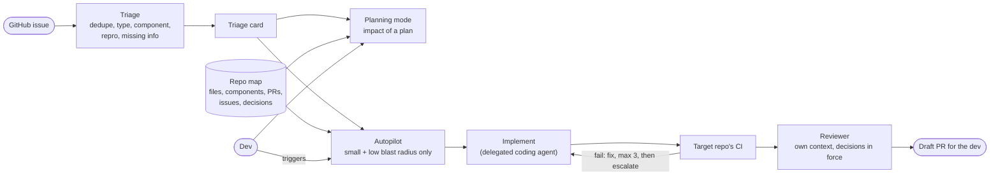

# cofabriq

A software factory that devs use as a tool, not a review queue for them.

Most "AI software factory" pipelines turn issues into pull requests and leave
humans reviewing all day. cofabriq takes a different line. **Small,
low-risk issues** (a type change, a typo, a dependency bump) go through
**autopilot**: triage, implement on a branch, the repository's own CI as the
gate, a separate reviewer, and a draft PR for the dev who triggered it.
**Real features** stay with the dev, who plans them in **planning mode**: a
map of the repository answers what a change touches, which decisions
constrain it and what related work already exists.

Three things it is built around:

- **A number per stage.** Every retrieval or agent change is measured on a real
  issue history ([open-webui](https://github.com/open-webui/open-webui), frozen
  snapshot). The numbers live in this README.
- **Safe by default on public repos.** Read-only until v3. After that, writes
  happen only on a local trigger by the dev, as a dry run unless `--apply` is
  passed. They are limited to one branch and a draft PR by a scoped token, not
  by a prompt. Issue text is untrusted input.
- **Devs own it.** One issue, one dev who triggers it, one branch, one PR that
  same dev reviews.

Formerly `adrscape`. Why it changed: [ADR-006](docs/adr/006-re-scope-to-a-software-factory.md).

## Status

**v1 in progress: issue in, triage card out.** What runs today is the context
layer from v0. It ingests a repository's docs and manifests from local clones,
chunks and embeds them into pgvector for semantic search, extracts entities with
an LLM into a Neo4j graph, and serves it all as MCP tools. Issue ingestion,
dedupe and the triage card are next.

```bash
uv run cofabriq fetch ../repo-a ../repo-b   # READMEs, docs/, ADRs, manifests -> data/raw
uv run cofabriq embed                       # chunk + embed into pgvector, unchanged docs skipped
uv run cofabriq search "how are models loaded"
uv run cofabriq extract                     # LLM fills the domain schema -> data/extracted.json
uv run cofabriq graph                       # load the extraction into Neo4j
uv run cofabriq mcp                         # search + graph queries as MCP tools (stdio)
```

## How it fits together (target)



What cofabriq builds: triage, the repo map, the implement-and-fix loop, the
reviewer and blast-radius routing. What it consumes: the target repository's CI,
and a coding agent for implementation. What it does not read itself: source
code. The map gets its structure from file paths, manifests and git history.

## Quickstart

Requires [uv](https://docs.astral.sh/uv/) and Podman (or Docker) with compose.

```bash
make setup               # install deps, create .env (set OPENAI_API_KEY)
make up                  # Postgres + pgvector (5433), Neo4j (7474, 7687), test Neo4j (7688)
uv run cofabriq health   # OK per service
make check               # ruff, pyright (strict), pytest
```

## Roadmap

- [x] **v0 (as adrscape):** context layer over a repository's docs: fetch,
      parse, chunk, embed, semantic search, LLM extraction, graph, MCP tools
- [ ] **v1: issue in, triage card out (read-only).** GitHub issues as a
      source, two-stage dedupe (vector candidates, LLM verdict with checked
      evidence), triage card, `triage` CLI and MCP tool. Numbers: recall@5,
      verdict precision and recall against an embedding baseline, cost and
      latency per issue
- [ ] **v2: repo map + planning mode (read-only).** Components, files,
      co-change, PRs, issues and decisions in Neo4j; `impact` of an issue or
      a plan. Number: predicted vs actually touched components
- [ ] **v3: autopilot.** Refinement, size and blast-radius gate, delegated
      implementation, the target's CI as the gate, fix loop with escalation,
      draft PR
- [ ] **v4: review.** Reviewer with its own context, blast-radius routing
      (human review vs auto-merge eligible), run metrics

Decisions are recorded in `docs/adr/` as they are made.

## How this is built

With Claude Code as a pair programmer. Architecture, scope and trade-offs are
mine and written down as ADRs; every change is reviewed before it lands.
