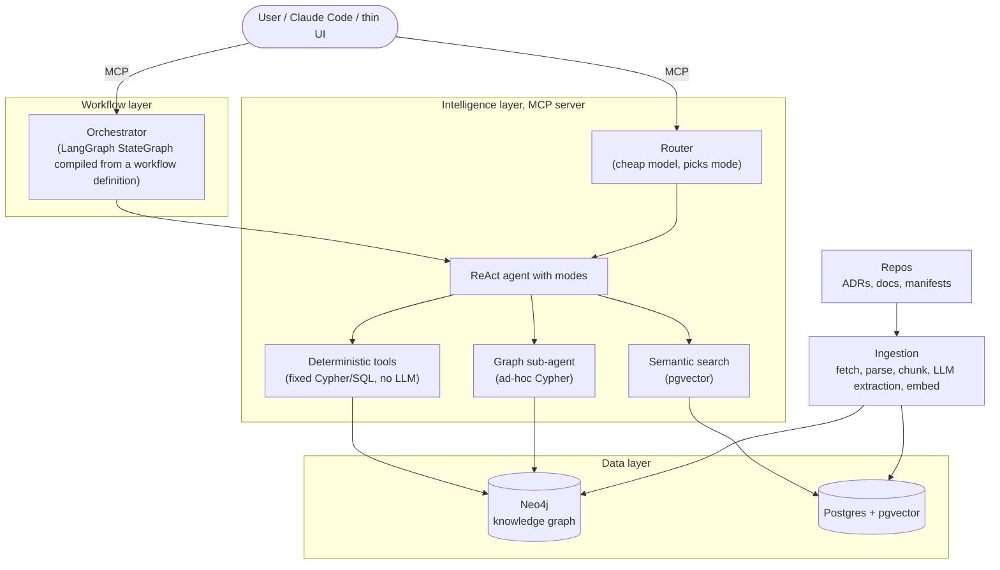

# adrscape

A map of a company's engineering decisions.

Teams write ADRs, READMEs and design docs faster than ever, spread over dozens of
repositories. A new architect joining the company asks the same three questions
every time: **what is here, has anyone decided this before, and does my new
proposal fit?** adrscape reads the decision records, docs and manifests of many
repos, builds a knowledge graph of projects, decisions, owners, technologies and
dependencies, makes the content searchable by meaning, and exposes all of it as
MCP tools. An agent answers questions on top; a workflow layer runs repeatable
processes like ADR review.

## Status

**v0 in progress.** What runs today: both databases in compose, a health check,
and the first `Source`: `uv run adrscape docs <repo>...` lists the ADRs, READMEs,
docs and manifests it would ingest from local git clones. Nothing is stored yet.
Why: [ADR-001](docs/adr/001-source-protocol-and-document-identity.md).

## Architecture (target)



Two databases on purpose: pgvector answers "what is similar in meaning"
("did we decide anything about message queues?" finds an ADR that only says
"Kafka"); Neo4j answers "how is it connected" (which decision is in force, which
projects are affected if a protocol changes). The ADR for that choice lands with
the graph step.

**What adrscape reads:** ADRs, READMEs, `docs/` and manifests (`package.json`,
`pyproject.toml`, compose files). **What it does not read:** the source code
itself. Decisions and dependencies are written down in docs and manifests;
searching code is a separate problem that tools like Sourcegraph already solve.

## Quickstart

Requires [uv](https://docs.astral.sh/uv/) and Podman (or Docker) with compose.

```bash
make setup               # install deps, create .env
make up                  # Postgres + pgvector (port 5433), Neo4j (7474, 7687)
uv run adrscape health   # OK per service
make check               # ruff, pyright (strict), pytest
```

## Roadmap

- [ ] **v0:** ingest a small fixture (fetch, parse, chunk, LLM extraction, embed),
      graph schema, semantic search, first MCP tools, deployed
- [ ] **v1:** larger public corpus, golden set, recall@k and MRR, hybrid
      retrieval, reranking; every change gets a number
- [ ] **v2:** router, agent with graph sub-agent, guardrails (ingested docs are
      untrusted input), model routing with cost per query, traces, thin UI
- [ ] **v3:** workflow layer: ADR review and landscape report as compiled
      LangGraph workflows
- [ ] **v4:** Kubernetes, CI running the eval suite on every PR

Decisions are recorded in `docs/adr/` as they are made.

## How this is built

With Claude Code as a pair programmer. Architecture, scope and trade-offs are
mine and written down as ADRs; every change is reviewed before it lands.
